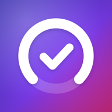

# Abonelik Takip – Hatırlatıcı

**Tüm dijital aboneliklerin tek bir yerde.** 
Ne kadar ödediğini gör, ödeme gününden önce haberin olsun, verin telefonunda kalsın.

[App Store](https://apps.apple.com/app/id6831321319) · [Destek](https://mugione.github.io/abonelik/) · [Gizlilik Politikası](https://mugione.github.io/abonelik/gizlilik.html)

---

## Özellikler

- **Tek bakışta özet:** aylık ve yıllık toplam, bu ay ödenecek tutar, kategoriye göre harcama grafiği
- **Saniyeler içinde ekleme:** 40'tan fazla hazır servis şablonu, Türkiye'deki platformlar dahil
- **Ödeme hatırlatması:** ödemeden 1–7 gün önce yerel bildirim
- **Esnek takip:** haftalık, aylık, 3 aylık, yıllık; TRY, USD, EUR, GBP
- **Yedekleme:** JSON yedek, CSV dışa aktarma, geri yükleme
- **Gizlilik:** hesap yok, reklam yok, analitik yok; uygulama internete bağlanmaz

## Bu repo

Bu depo uygulamanın kaynak kodunu değil, GitHub Pages ile yayınlanan destek ve gizlilik sayfalarını içerir.

| Dosya | Sayfa |
|---|---|
| `index.html` | [Destek ve SSS](https://mugione.github.io/abonelik/) |
| `gizlilik.html` | [Gizlilik Politikası](https://mugione.github.io/abonelik/gizlilik.html) |
| `style.css`, `icon.png` | Sayfa stili ve ikon |

## İletişim

Soru, hata bildirimi veya öneri için [destek sayfasındaki](https://mugione.github.io/abonelik/) e-posta adresini kullanabilir ya da bu depoda bir *issue* açabilirsin.

---

Uygulamada görünen servis adları ve logoları ilgili şirketlerin tescilli markalarıdır; Abonelik Takip bu şirketlerle bağlantılı değildir. © 2026 Murat Gülsen
